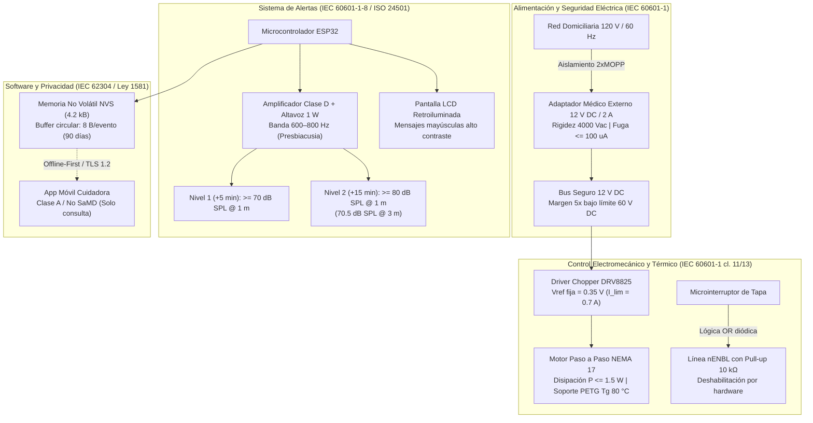

# 14. Definición de Estrategia Regulatoria y Normativa Aplicada

**Proyecto:** Sistema Inteligente de Dispensación de Medicamentos (DIM)  
**Marco Regulatorio:** INVIMA Decreto 4725/2005, FDA 21 CFR, IEC 60601-1, IEC 60601-1-2, IEC 60601-1-8, IEC 60601-1-11, IEC 62304, IEC 82304-1, ISO 14971, ISO 10993-1, Ley 1581/2012, Ley 1618/2013 y WCAG 2.2 AA.  
**Alcance:** Prototipo funcional pre-comercial para entorno domiciliario, diseñado bajo criterios estrictos de cumplimiento normativo por arquitectura (*pre-compliance by design*).

---

## Estrategia de Cumplimiento

La estrategia adoptada para el sistema DIM no se limita a un inventario declarativo de normas, sino que establece una **justificación técnica demostrable mediante cálculo ingenieril, modelado físico y selección de componentes pre-certificados**.

---

## Clasificación Regulatoria Oficial

### 1. Clasificación Nacional (Colombia - INVIMA)
* **Norma:** Decreto 4725 de 2005 (modificado por Decreto 582 de 2017).
* **Regla Aplicable:** **Regla 12 → Clase I (Riesgo Bajo).**
* **Justificación Técnica y Operativa:**  
  El dispositivo DIM es un equipo activo electromecánico de asistencia para la vida diaria que almacena y **dispensa** formas farmacéuticas sólidas orales hacia un receptáculo exterior accesible para el usuario.  
  * **Distinción Crítica con Regla 11 (Clase IIa):** La Regla 11 rige para dispositivos destinados a *administrar* medicamentos o líquidos hacia el interior del organismo humano (como bombas de infusión enteral/parenteral o inyectores automáticos). El sistema DIM **no introduce ni dosifica fármacos dentro del cuerpo humano**, sino que libera voluntariamente la dosis en una bandeja para que el paciente la ingiera por sí mismo. Toda la documentación del DHF debe mantener la terminología unificada de **"dispensación"** y erradicar el término "administración".

### 2. Clasificación Internacional (Estados Unidos - FDA)
* **Clasificación:** **Clase I (Exento de notificación 510(k))**.
* **Código de Producto:** **NXB** (*Dispenser, Liquid Medication / Daily Activity Assist Device*).
* **Regulación:** 21 CFR 890.5050 (*Physical medicine prosthetic devices - Daily activity assist device*).

---

## 1. Seguridad Eléctrica y Aislamiento — IEC 60601-1

### 1.1. Datos de Entrada y Criterio de Aislamiento
* **Tensión de red:** $120\ \text{V}_{\text{AC}} \pm 10\ \% \rightarrow V_{\text{máx}} = 132\ \text{V}_{\text{rms}}$ a $60\ \text{Hz}$ (rango $\le 250\ \text{V}_{\text{rms}}$).
* **Condición de usuario:** La paciente geriátrica interactúa directamente con el equipo en su hogar, fungiendo de manera simultánea como operadora y paciente. Por consiguiente, se exigen **2×MOPP (Medios de Protección al Paciente)** entre la red eléctrica y cualquier parte accesible.

| Requisito Dieléctrico | Rigidez Dieléctrica | Distancia de Fuga (*Creepage*) | Distancia en Aire (*Clearance*) | Corriente de Fuga a Tierra |
|---|---|---|---|---|
| **2×MOPP ($\le 250\ \text{V}_{\text{rms}}$)** | $4.000\ \text{V}_{\text{AC}}$ | $\ge 8{,}0\ \text{mm}$ | $\ge 5{,}0\ \text{mm}$ | $\le 100\ \mu\text{A}$ (NC) |

* **Criterio de Cumplimiento por Selección:**  
  El aislamiento de alta tensión **no se diseña dentro de la PCB del prototipo; se selecciona de forma certificada en el primario**. Se implementa una fuente de alimentación médica conmutada externa (adaptador de pared) con homologación IEC 60601-1 3.ª/4.ª edición, 2×MOPP, con salida de **$12\ \text{V}_{\text{DC}} \pm 5\ \%$ y capacidad de $2\ \text{A}$ ($24\ \text{W}$)**.  
  Dentro del chasis del dispensador **no entra corriente alterna de 120 V**. La entrada al equipo es a través de un conector cilíndrico estándar (*barrel jack* de $2{,}1\ \text{mm}$) exclusivamente a $12\ \text{V}_{\text{DC}}$.

### 1.2. Cálculo de Tensión Accesible
Según la cláusula 8.4.2 de la norma IEC 60601-1, las tensiones que no superen $60\ \text{V}_{\text{DC}}$ en régimen continuo se consideran seguras frente al choque eléctrico en partes accesibles en entorno seco:

$$\text{Margen de Tensión} = \frac{V_{\text{límite}}}{V_{\text{nominal}}} = \frac{60\ \text{V}_{\text{DC}}}{12\ \text{V}_{\text{DC}}} = 5{,}0\times$$

En la condición de sobretensión máxima del adaptador ($12\ \text{V} \times 1{,}10 = 13{,}2\ \text{V}_{\text{DC}}$):

$$13{,}2\ \text{V}_{\text{DC}} \ll 60\ \text{V}_{\text{DC}} \quad (\text{Cumple con margen de } 4{,}54\times)$$

### 1.3. Balance de Potencia y Corriente
El consumo nominal del sistema en el escenario más exigente (giro de carrusel con motor energizado, transmisión Wi-Fi pico, altavoz al 100 % y retroiluminación LCD encendida) se desglosa a continuación:

| Subsistema / Carga | Tensión de Operación | Corriente Pico | Potencia de Consumo |
|---|---|---|---|
| Motor NEMA 17 (limitado a $0{,}7\ \text{A/fase}$) | $12\ \text{V}_{\text{DC}}$ | $0{,}125\ \text{A}$ promedio | $1{,}50\ \text{W}$ |
| Microcontrolador ESP32-WROOM-32E (pico Wi-Fi) | $3{,}3\ \text{V}_{\text{DC}}$ | $0{,}500\ \text{A}$ | $1{,}65\ \text{W}$ |
| Amplificador de Audio Clase D (Nivel 2: $80\ \text{dB}$) | $5\ \text{V}_{\text{DC}}$ | $0{,}100\ \text{A}$ | $0{,}50\ \text{W}$ |
| Pantalla LCD $16\times 2$ / Retroiluminación | $5\ \text{V}_{\text{DC}}$ | $0{,}040\ \text{A}$ | $0{,}20\ \text{W}$ |
| Sensor óptico infrarrojo + LEDs guía | $3{,}3\ \text{V}_{\text{DC}} / 5\ \text{V}_{\text{DC}}$ | $0{,}060\ \text{A}$ | $0{,}25\ \text{W}$ |
| **Subtotal Consumos Internos** | — | — | **$4{,}10\ \text{W}$** |
| Eficiencia de regulador reductor *buck* ($\eta \approx 85\ \%$) | — | — | **$P_{\text{total}} \approx \frac{4{,}10}{0{,}85} = 4{,}82\ \text{W}$** |

$$\text{Corriente Total Demandada a } 12\ \text{V}_{\text{DC}}: I_{\text{in}} = \frac{4{,}82\ \text{W}}{12\ \text{V}} = 0{,}402\ \text{A}$$

$$\text{Margen de Potencia del Adaptador} = \frac{I_{\text{fuente}}}{I_{\text{in}}} = \frac{2{,}00\ \text{A}}{0{,}402\ \text{A}} \approx 4{,}97\times \quad (\approx 5\times)$$

El margen de potencia ($5\times$) absorbe de manera holgada las corrientes transitorias inductivas de conmutación del motor y los picos de radiofrecuencia del transceptor Wi-Fi/BLE.

### 1.4. Red de Protección en Entrada de Alimentación
Para blindar el circuito interno ante anomalías de línea, la placa incorpora:
1. **Diodo Schottky (SS34, 3 A / 40 V):** Protección contra polaridad inversa accidental en el jack.
2. **Supresor de Transitorios TVS (SMAJ15A):** Fijación de picos de tensión (*clamping*) a $\le 15\ \text{V}$ ante transitorios inducidos en el cable.
3. **Fusible Reajustable PTC ($0{,}75\ \text{A}$ sostenido / $1{,}5\ \text{A}$ disparo):** Corte térmico automático ante cortocircuitos francos en el bus de 12 V.

---

## 2. Calentamiento y Seguridad del Motor — IEC 60601-1 cl. 11 y 13

### 2.1. Modelo Térmico y Cálculo de Disipación
Se utiliza un motor paso a paso bipolar NEMA 17 (modelo tipo 17HS4401: corriente nominal $1{,}7\ \text{A/fase}$, resistencia de devanado $R = 1{,}5\ \Omega/\text{fase}$, par de retención $0{,}40\ \text{N}\cdot\text{m}$).  
En los controladores de micropaso con topología *chopper*, el driver mantiene la corriente constante en los devanados mediante modulación PWM incluso con el rotor bloqueado. La potencia calorífica disipada en el estator con dos fases energizadas se rige por la ley de Joule:

$$P_{\text{disipada}} = 2 \cdot I_{\text{fase}}^2 \cdot R_{\text{bobina}}$$

* **Escenario 1 (Sin limitación - Corriente Nominal $1{,}7\ \text{A}$):**
  $$P = 2 \cdot (1{,}7\ \text{A})^2 \cdot 1{,}5\ \Omega = 8{,}67\ \text{W}$$
  *Riesgo intolerable:* Una disipación continua de $8{,}67\ \text{W}$ en régimen estacionario eleva la temperatura de la carcasa del motor por encima de los $75\ ^\circ\text{C}$, superando la temperatura de transición vítrea ($T_g$) del PLA común ($\approx 60\ ^\circ\text{C}$), provocando el ablandamiento de la estructura mecánica y deformación del chasis.

* **Escenario 2 (Con Limitación por Hardware a $0{,}7\ \text{A}$):**
  $$P = 2 \cdot (0{,}7\ \text{A})^2 \cdot 1{,}5\ \Omega = 1{,}47\ \text{W} \le 1{,}5\ \text{W}$$
  *Reducción térmica:* Se reduce la potencia calórica en un **$83\ \%$**, manteniendo la temperatura de equilibrio superficial por debajo de $40\ ^\circ\text{C}$ en temperatura ambiente de $25\ ^\circ\text{C}$ (muy por debajo de los límites de partes táctiles de la cl. 11 de IEC 60601-1).

* **Escenario 3 (Driver Deshabilitado en Reposo):**
  $$P = 2 \cdot (0\ \text{A})^2 \cdot 1{,}5\ \Omega = 0\ \text{W}$$

### 2.2. Par Disponible con Corriente Limitada
El par entregado por el motor paso a paso es proporcional a la corriente de fase:

$$T_{\text{disp}} \approx T_{\text{nom}} \cdot \left(\frac{I_{\text{fase}}}{I_{\text{nom}}}\right) = 0{,}40\ \text{N}\cdot\text{m} \cdot \left(\frac{0{,}7\ \text{A}}{1{,}7\ \text{A}}\right) \approx 0{,}165\ \text{N}\cdot\text{m} = 16{,}5\ \text{N}\cdot\text{cm}$$

Dado que el carrusel de 8 compartimentos gira sobre un rodamiento con baja fricción estática ($T_{\text{fricción}} \le 0{,}02\ \text{N}\cdot\text{m}$), el par resultante de $0{,}165\ \text{N}\cdot\text{m}$ ofrece un **factor de seguridad mecánico $> 8\times$** para indexar los compartimentos sin pérdida de pasos.

### 2.3. Fijación de $V_{\text{ref}}$ en el Driver DRV8825 (Limitación por Hardware)
Para garantizar el principio de seguridad en **primer defecto** (*single fault safe*), la corriente no se programa por software; se calibra analógicamente mediante el potenciómetro de la tensión de referencia ($V_{\text{ref}}$) del driver DRV8825. Con resistencias de sensado de corriente $R_{\text{sense}} = 0{,}10\ \Omega$:

$$I_{\text{lím}} = \frac{V_{\text{ref}}}{5 \cdot R_{\text{sense}}} = \frac{V_{\text{ref}}}{5 \cdot 0{,}10\ \Omega} = 2 \cdot V_{\text{ref}}$$

Despejando $V_{\text{ref}}$ para una corriente límite de $0{,}7\ \text{A}$:

$$V_{\text{ref}} = \frac{I_{\text{lím}}}{2} = \frac{0{,}70\ \text{A}}{2} = 0{,}35\ \text{V} \quad (350\ \text{mV})$$

*Criterio de verificación:* Medición obligatoria con multímetro calibrado entre el cursor del potenciómetro y GND antes del montaje, registrada como evidencia de control de calidad.

### 2.4. Medidas de Control y Protección Asociadas
1. **Lógica Fail-Safe del Pin `nENBL`:**  
   El pin de habilitación del DRV8825 es activo en bajo (0 V = encendido; VCC = alta impedancia/apagado). Se instala una **resistencia de pull-up física externa de $10\ \text{k}\Omega$ conectada a VCC**. Ante cualquier reinicio de la MCU, bloqueo de firmware o desconexión, el pin queda fijado a nivel alto, desconectando inmediatamente la energía de las bobinas del motor.
2. **Interbloqueo de Tapa por Hardware (*Safety Interlock*):**  
   Para anular el riesgo de atrapamiento mecánico de dedos en los engranajes o carrusel (Peligro R6), se instala un microinterruptor mecánico normalmente cerrado (NC) en el cierre de la tapa superior. El microinterruptor se interconecta en lógica **OR por diodos** sobre la línea `nENBL`:

   $$\text{nENBL} = \text{MCU}_{\text{deshabilita}} \lor \text{Tapa abierta}$$

   Al levantarse la tapa, la línea se conecta a nivel alto de forma puramente física/cableada, cortando el par del motor con independencia del estado del microcontrolador.
3. **Monitoreo de Falla Térmica (`nFAULT`):**  
   La salida de drenador abierto `nFAULT` del DRV8825 se conecta a un pin de interrupción externa del ESP32 con pull-up. Si se produce sobrecorriente o sobrecalentamiento interno del chip ($\ge 150\ ^\circ\text{C}$), la línea cae a nivel bajo y el firmware interrumpe el ciclo e informa una falla técnica en pantalla.
4. **Material de Chasis y Soporte del Motor:**  
   El soporte estructural del motor se fabrica obligatoriamente en **PETG** ($T_g \approx 80\ ^\circ\text{C}$) o ABS ($T_g \approx 105\ ^\circ\text{C}$), descartando el PLA para garantizar estabilidad dimensional bajo carga térmica.

---

## 3. Entorno Domiciliario y Envolvente — IEC 60601-1-11

### 3.1. Requisitos para Uso sin Supervisión Médica
Los equipos de salud domiciliarios deben resistir derrames accidentales, polvo doméstico e ingreso de partículas sólidas. Se adopta la clasificación **IP21** (protección contra partículas sólidas $\ge 12{,}5\ \text{mm}$ y caída vertical de gotas de agua).

### 3.2. Criterios de Diseño Mecánico de la Envolvente
1. **Ausencia de Aberturas Superiores:** La cara superior del chasis es completamente lisa, continua y sin ranuras de ventilación ni uniones directas sobre los circuitos electrónicos.
2. **Ubicación de Conectores y Rejillas:** El conector de alimentación de 12 V DC y las aberturas de evacuación acústica del altavoz se disponen en la **cara posterior inferior**, protegidos por pestañas deflectoras con ángulo descendente $\ge 45^\circ$.
3. **Hermeticidad de los Compartimentos:** El carrusel cuenta con un labio perimetral de sellado que evita que el derrame accidental de un vaso de agua en la mesita de noche penetre a los compartimentos de los fármacos.
4. **Protocolo de Ensayo:** Prueba de goteo de agua a una tasa de $1\ \text{mm/min}$ durante 10 minutos (IEC 60529 cl. 13.2) con el prototipo energizado en posición normal de trabajo, verificando rigidez dieléctrica posterior y ausencia de agua en cavidades eléctricas.

---

## 4. Compatibilidad Electromagnética y Radio — IEC 60601-1-2 / Res. CRC 5050/2016

### 4.1. Entorno de Compatibilidad y Niveles de Inmunidad
* **Descarga Electrostática (ESD - IEC 61000-4-2):** $\pm 8\ \text{kV}$ en contacto directo / $\pm 15\ \text{kV}$ a través del aire sobre todas las partes accesibles por el usuario (botones, marco de pantalla y chasis).
* **Campos Electromagnéticos de RF Radiados (IEC 61000-4-3):** Nivel de inmunidad de $10\ \text{V/m}$ en el rango de $80\ \text{MHz}$ a $2{,}7\ \text{GHz}$ (protección contra interferencias de teléfonos móviles, hornos microondas y routers domésticos).

### 4.2. Medidas de Diseño en Hardware
1. **Módulo de Comunicaciones Pre-Certificado:** Se emplea el módulo **ESP32-WROOM-32E**, el cual cuenta con blindaje metálico (*shielding can*) y pre-certificación de emisiones e inmunidad bajo normas FCC Parte 15B / CE-RED.
2. **Enrutamiento de Antena:** Zona de exclusión estricta de pistas de cobre y planos de masa (*keep-out zone*) debajo de la antena PCB integrada del ESP32.
3. **Supresión de Ruido Conmutado:** Se instala un condensador electrolítico de bajo ESR de $100\ \mu\text{F} / 25\ \text{V}$ en paralelo con un condensador cerámico multicapa (MLCC) de $100\ \text{nF}$ pegado a los terminales de alimentación del DRV8825 para absorber los transitorios inductivos de conmutación del motor paso a paso.
4. **Cables Trenzados:** Las 4 líneas de las bobinas del motor paso a paso se trenzan en pares bifilares para anular emisiones radiadas por bucle y se mantienen físicamente separadas del transceptor Wi-Fi.

### 4.3. Desempeño Esencial Offline-First
La pérdida total o degradación del enlace inalámbrico Wi-Fi **no compromete la dispensación programada, la activación de las alarmas sonoras/visuales ni el bloqueo de seguridad**. La conectividad Wi-Fi se utiliza exclusivamente de forma asíncrona para sincronización de telemetría hacia la nube y alertas secundarias a la cuidadora. Se verifica con un ensayo de estrés de 24 horas continuas de dispensaciones programadas manteniendo el router apagado.

### 4.4. Regulación Nacional de Espectro (Resolución CRC 5050 de 2016)
La homologación obligatoria ante la Comisión de Regulación de Comunicaciones (CRC) de Colombia aplica a equipos terminales móviles que se conectan a redes celulares (2G/3G/4G/5G). Al operar únicamente en bandas libres de $2{,}4\ \text{GHz}$ (Wi-Fi 802.11 b/g/n y Bluetooth Low Energy 4.2), el dispositivo queda exento del trámite de homologación celular; en fase de comercialización se tramita una solicitud de carta de no pertinencia ante la CRC.

---

## 5. Sistema de Alertas y Ergonomía Sensorial — IEC 60601-1-8 / ISO 24501

### 5.1. Matriz de Escalamiento de Alarmas

| Nivel | Condición Temporal | Prioridad IEC 60601-1-8 | Indicador Visual (Pantalla LCD $16\times 2$) | Patrón Acústico | Nivel de Presión Sonora ($L_p$ a 1 m) |
|---|---|---|---|---|---|
| **0** | $T_0$ (Hora exacta programada) | Señal de Información | Mensaje fijo: `"HORA DE MEDICACION"` / `"CARTUCHO N"` | Tono discreto único (1 pulso de 500 ms) | $60\ \text{dB}$ |
| **1** | $T_0 + 5\ \text{min}$ (Sin retiro detectado) | Alarma de Baja Prioridad | Mensaje fijo: `"RETIRE SU DOSIS"` / Luz LED azul en cartucho | Ráfaga repetida de 2 pulsos cada 15 s | **$\ge 70\ \text{dB SPL}$** |
| **2** | $T_0 + 15\ \text{min}$ (Dosis pendiente) | Baja Prioridad Escalada | Mensaje: `"DOSIS PENDIENTE"` / Notificación push móvil a cuidadora | Ráfaga de 3 pulsos continuos cada 8 s | **$\ge 80\ \text{dB SPL}$** |
| **—** | Falla técnica (Atasco / Switch tapa / Error NVS) | Alarma Técnica de Media Prioridad | Mensaje intermitente ($2\ \text{Hz}$): `"FALLA TECNICA: N"` | Tono bitonal rápido y continuo | $\ge 75\ \text{dB SPL}$ |

### 5.2. Criterio Psicoacústico y Selección de Frecuencia (Presbiacusia)
El deterioro auditivo natural asociado al envejecimiento (presbiacusia) afecta primariamente las frecuencias altas por encima de $2{,}5\ \text{kHz}$. Los transductores piezoeléctricos comerciales económicos suelen operar en resonancia fija entre $2{,}7\ \text{kHz}$ y $4{,}5\ \text{kHz}$, lo que los hace virtualmente inaudibles para ancianos con hipoacusia neurosensorial.  
* **Criterio Técnico Adoptado:**  
  La norma IEC 60601-1-8 exige una frecuencia fundamental comprendida entre $150\ \text{Hz}$ y $1.000\ \text{Hz}$ con armónicos presentes. Se selecciona una frecuencia fundamental de **$600\ \text{Hz}$ a $800\ \text{Hz}$**.  
  *Implementación:* Se descartan los buzzers piezoeléctricos y se incorpora un **altavoz magnético dinámico de bobina móvil de $\ge 1\ \text{W}$ ($8\ \Omega$) excitado mediante un amplificador de audio digital Clase D (PAM8302A)** gobernado por salida DAC/PWM del ESP32.

### 5.3. Atenuación Acústica por Distancia (Propagación Esférica)
Para garantizar que la alarma de Nivel 2 alerte a la cuidadora familiar situada en una habitación contigua a una distancia de $r_2 = 3\ \text{m}$, considerando la divergencia geométrica en campo libre:

$$L_p(r_2) = L_p(r_1) - 20\log_{10}\left(\frac{r_2}{r_1}\right)$$

Con $L_p(1\ \text{m}) = 80\ \text{dB SPL}$:

$$L_p(3\ \text{m}) = 80\ \text{dB} - 20\log_{10}(3) = 80 - 9{,}54 = 70{,}46\ \text{dB SPL}$$

Incluso considerando una atenuación estructural de tabique doméstico de $\sim 15\ \text{dB}$, el nivel de presión sonora resultante en la habitación contigua ($\approx 55{,}5\ \text{dB SPL}$) supera el umbral de ruido de fondo nocturno/diurno ($\sim 40\text{--}45\ \text{dB SPL}$), garantizando la percepción oportuna.

### 5.4. Cálculo de Potencia Eléctrica de Audio
Para un altavoz comercial de $8\ \Omega$ con sensibilidad nominal $S = 85\ \text{dB SPL}$ a $1\ \text{W} / 1\ \text{m}$:

$$L_p = S + 10\log_{10}(P_{\text{audio}}) \implies P_{\text{audio}} = 10^{\frac{L_p - S}{10}}$$

* **Para Nivel 1 ($70\ \text{dB SPL}$):**
  $$P_{\text{audio}} = 10^{\frac{70 - 85}{10}} = 10^{-1{,}5} = 0{,}0316\ \text{W} \approx 32\ \text{mW}$$
* **Para Nivel 2 ($80\ \text{dB SPL}$):**
  $$P_{\text{audio}} = 10^{\frac{80 - 85}{10}} = 10^{-0{,}5} = 0{,}316\ \text{W} \approx 316\ \text{mW}$$

Un amplificador de audio de $1\ \text{W}$ a $2{,}5\ \text{W}$ opera holgadamente con una distorsión armónica total (THD) inferior al $1\ \%$, asegurando la inteligibilidad de las alertas.

---

## 6. Biocompatibilidad e Higiene de Contacto — ISO 10993-1 / FDA 21 CFR 177.1520

### 6.1. Categorización de Contacto Biológico
Conforme a la tabla de evaluación de la norma ISO 10993-1:2018:

| Elemento / Pieza | Categoría de Contacto | Naturaleza del Contacto | Tiempo de Contacto | Ensayos Exigibles (si no hay datos) |
|---|---|---|---|---|
| **Carcasa exterior, bisel y pulsadores** | Dispositivo en contacto superficial | Piel intacta | Prolongado ($> 24\ \text{h}$ a $30\ \text{d}$) | Citotoxicidad (ISO 10993-5), Sensibilización (ISO 10993-10), Irritación (ISO 10993-23) |
| **Bandeja de dispensación de medicamentos** | Contacto superficial transitorio | Piel intacta | Breve ($< 24\ \text{h}$, contacto repetido) | Justificación toxicológica |
| **Compartimentos internos y ducto de caída** | Contacto indirecto con el paciente (Contacto directo con el fármaco sólido) | Interacción material-medicamento | Prolongado (almacenamiento del comprimido) | Seguridad alimentaria / farmacéutica (*Leachables & Extractables*) |

### 6.2. Criterio de Selección de Materiales por Justificación Técnica
La conformidad biológica se alcanza mediante la **selección informada de polímeros comerciales con historial clínico documentado y grado alimentario/médico certificado**, evitando la ejecución de bioensayos en animales para un prototipo pre-comercial:

1. **Carcasa y Chasis (PETG - Polietileno Tereftalato de Glicol):**
   * *Justificación:* Material inerte con amplio uso en órtesis y contenedores clínicos. Presenta alta resistencia al impacto, baja absorción de humedad y estabilidad térmica ($T_g \approx 80\ ^\circ\text{C}$).
2. **Pulsadores e Interfaces de Presión (Silicona de Grado Médico / TPU 95A):**
   * *Justificación:* Ampliamente caracterizado en dispositivos de uso continuo; no citotóxico y exento de látex o ftalatos.
3. **Compartimentos de Fármacos (Insertos Comerciales de Polipropileno - PP Grado Alimentario):**
   * *Problema de la Impresión 3D FDM:* Los componentes impresos en filamento depositan capas sucesivas que generan microporosidades microscópicas ($\approx 50\text{--}200\ \mu\text{m}$). Estas estrías acumulan humedad, atrapan polvo de fármacos triturados y actúan como nichos de proliferación bacteriana y fúngica, haciendo inviable su esterilización o limpieza rutinaria.
   * *Solución Técnica de Diseño:* El carrusel mecánico impreso en PETG actúa únicamente como **esqueleto rotatorio portador**. El fármaco se almacena exclusivamente dentro de **8 cápsulas/insertos comerciales independientes fabricados mediante inyección de Polipropileno (PP) virgen conforme a FDA 21 CFR 177.1520**. El PP grado alimentario es químicamente inerte, no hidrófilo, cuenta con superficies lisas no porosas aptas para lavado y esterilización química en frío, y no desprende partículas sobre las pastillas.

---

## 7. Arquitectura de Software y Firmware — IEC 62304 / IEC 82304-1 / IMDRF SaMD

### 7.1. Clasificación del Firmware del ESP32 (SiMD - Software in a Medical Device)
* **Clasificación Inicial:** **Clase C** (según IEC 62304 cl. 4.3).
* **Justificación Clínica del Riesgo:** El sistema administra esquemas para pacientes geriátricos con polifarmacia, incluyendo medicamentos de estrecho índice terapéutico como anticoagulantes (Warfarina), antihipertensivos o hipoglucemiantes orales. Una falla no detectada en la secuencia del firmware podría girar el carrusel y suministrar una **sobredosis doble o triple**, o suministrar el fármaco en horario indebido, lo cual puede generar hemorragia digestiva severa, shock hipoglucémico o muerte (lesión grave/muerte $\rightarrow$ Clase C).
* **Clasificación Resultante:** **Clase C estricta.**  
  La norma IEC 62304 prohíbe explícitamente reducir la clase de seguridad de un software basándose en medidas de mitigación que dependan del mismo software que puede fallar. En consecuencia, el firmware asume la totalidad de exigencias Clase C:
  * Requisitos de software trazables a especificaciones del DHF.
  * Arquitectura desacoplada en módulos de seguridad segregados (control de motor, reloj RTC, verificación de ventana horaria y registrador de eventos).
  * Verificación unitaria obligatoria y pruebas de caja blanca para cada unidad de los módulos de seguridad.

### 7.2. Controles de Riesgo de Software Implementados
1. **Bloqueo Inviolable de Intervalo Mínimo (*Interlock por Software*):**  
   Tras detectarse la caída de una pastilla, el firmware escribe en la partición no volátil (NVS) la marca de tiempo de la última dispensación. Cualquier solicitud subsiguiente de giro de carrusel antes de cumplirse el tiempo mínimo configurado (p. ej., 2 horas) es **rechazada y abortada**, incluso si el microcontrolador sufre un corte de energía o reinicio forzado.
2. **Una Dosis por Giro:**  
   El motor avanza paso a paso a velocidad controlada. Al momento exacto en que el sensor óptico de barrera detecta el paso de la píldora, se dispara una interrupción de hardware (`ISR`) que pone inmediatamente el pin `nENBL` en nivel alto (apagado de motor), deteniendo el movimiento y registrando el evento.
3. **Temporizador Perro Guardián (*Hardware Watchdog Timer - WDT*):**  
   Se configura el WDT por hardware del ESP32 con un tiempo límite de $2{,}0\ \text{s}$. Ante cualquier cuelgue en un bucle infinito o desbordamiento de pila, el microcontrolador se reinicia automáticamente; al arrancar, el estado por defecto de los pines de I/O y la pull-up física garantizan que el motor no gire de forma espuria.

### 7.3. Calificación de la Aplicación Móvil de la Cuidadora (IMDRF SaMD N10/N12)
* **¿Es SaMD (Software as a Medical Device)?:** **No.**  
  Conforme a la guía IMDRF/SaMD WG/N10FINAL:2013 y la *Policy for Device Software Functions and Mobile Medical Applications* de la FDA (Sección V.B, Apéndice B), las aplicaciones que registran y muestran datos de adherencia farmacológica o actúan como recordatorios para la salud sin procesar diagnósticos ni alterar planes terapéuticos quedan bajo **discreción regulatoria (*enforcement discretion*)**.
* **Condición de Frontera Mandatoria:**  
  Para conservar esta condición, la aplicación móvil de la cuidadora **tiene estrictamente prohibido ordenar dispensaciones electromecánicas remotas**. Toda dispensación debe realizarse de forma presencial y física en el dispensador. La app solo opera como monitor informativo y gestor de configuración.
* **Clasificación según IMDRF N12 / IEC 82304-1:**  
  En el escenario de categorización formal:
  * *Estado de Salud:* Seria (enfermedades crónicas con polifarmacia).
  * *Significado de la Información:* **Informar el manejo clínico** (solo notifica si el adulto mayor retiró la pastilla).
  * *Resultado:* **Categoría I (Riesgo Menor)** $\rightarrow$ Gobernado por **IEC 82304-1 / IEC 62304 Clase A**.

### 7.4. Accesibilidad e Inclusión — WCAG 2.2 AA / Ley Estatutaria 1618 de 2013
El diseño visual y táctil de la interfaz móvil para cuidadores y usuarios geriátricos cumple los criterios del nivel AA de las *Web Content Accessibility Guidelines* (WCAG 2.2):
* **Relación de Contraste (Criterio 1.4.3 / 1.4.11):** Relación mínima de contraste de texto normal sobre fondo $\ge 4{,}5:1$ (modificando las paletas secundarias a `#475650` sobre `#F5F7F3` con ratio $> 5{,}2:1$); contraste de componentes gráficos e íconos activos $\ge 3{,}0:1$.
* **No Exclusividad del Color (Criterio 1.4.1):** Ningún estado de la medicación (tomada, pendiente, omitida) se codifica exclusivamente con verde/rojo; cada estado va respaldado por un ícono representativo y una etiqueta textual explícita legible por daltonismo.
* **Objetivos Táctiles (Criterio 2.5.8):** Todos los botones y selectores táctiles presentan una dimensión mínima de **$48\times 48\ \text{dp}$**, facilitando la interacción en personas con temblor esencial o artritis.
* **Lectores de Pantalla (Criterios 1.1.1 y 4.1.2):** Todo elemento iconográfico cuenta con atributos `aria-label` descriptivos compatibles con TalkBack (Android) y VoiceOver (iOS).
* **Redundancia Multisensorial:** Toda alerta crítica combina notificación visual, texto y patrón háptico de vibración del smartphone.

---

## 8. Protección de Datos y Ciberseguridad — Ley 1581/2012 / IEC 81001-5-1

### 8.1. Principio de Minimización de Datos de Salud (Datos Sensibles)
Los registros de medicación constituyen datos de carácter sensible bajo la Ley Estatutaria 1581 de 2012 de Colombia. Para blindar el sistema frente a violaciones de privacidad, se aplica el principio de **Minimización de Datos en el Extremo (*Edge Privacy*)**:
* El dispensador **no conoce ni almacena nombres comerciales de medicamentos, fórmulas médicas ni números de cédula**.
* El firmware solo opera con identificadores numéricos ciegos de cartucho ($0$ a $7$). La asociación entre el cartucho $\#03$ y el fármaco "Losartán $50\ \text{mg}$" se almacena cifrada en la cuenta privada de la cuidadora en el servidor mediante clave derivada de usuario.

### 8.2. Estructura del Payload Atómico de Evento
Cada registro de dispensación se compacta en una estructura binaria de longitud fija de **8 Bytes**:

| Campo | Tipo de Dato | Tamaño | Descripción |
|---|---|---|---|
| `timestamp` | `uint32_t` | 4 Bytes | Tiempo Unix UTC (segundos desde el 01/01/1970) |
| `slot_id` | `uint8_t` | 1 Byte | Número de compartimento dispensado ($0\text{--}7$) |
| `status_code` | `uint8_t` | 1 Byte | Código de evento: $1 = \text{Exitoso}$, $2 = \text{Tardío}$, $3 = \text{Omitido}$, $4 = \text{Atasco}$ |
| `crc16` | `uint16_t` | 2 Bytes | Checksum CRC-16/CCITT para verificación de integridad de datos |
| **Total por Evento** | — | **8 Bytes** | Estructura atómica inmutable |

### 8.3. Cálculo de Memoria de Retención Local para 90 Días
De acuerdo con las especificaciones del DHF (Métrica 18 de `Especificaciones_de_Producto.md`), el dispositivo debe retener localmente un historial continuo de mínimo **90 días** (período estándar entre consultas de control médico en EPS):
* Tasa máxima de eventos: 6 tomas programadas diarias.

$$N_{\text{eventos}} = 90\ \text{días} \times 6\ \text{eventos/día} = 540\ \text{eventos}$$

$$M_{\text{necesaria}} = 540\ \text{eventos} \times 8\ \text{Bytes/evento} = 4.320\ \text{Bytes} \approx 4{,}22\ \text{kB}$$

*Implementación de Almacenamiento:*  
La partición no volátil (NVS) del ESP32 dispone típicamente de $24\ \text{kB}$ a $64\ \text{kB}$ de memoria flash. Los $4{,}22\ \text{kB}$ requeridos ocupan menos del **$18\ \%$ de una partición NVS estándar**, implementándose como un **búfer circular FIFO** con sobreescritura automática de eventos que superen los 90 días de antigüedad.

### 8.4. Medidas de Seguridad de Comunicaciones
* **Cifrado en Tránsito:** Toda sincronización de red con el backend se ejecuta a través de sesiones cifradas mediante **TLS 1.2 o TLS 1.3** con conjuntos de cifrado seguros (ECDHE-RSA-AES128-GCM-SHA256).
* **Ausencia de Credenciales por Defecto (CWE-798):** Se prohíbe la inclusión de claves API o tokens maestros en texto plano en el firmware. El aprovisionamiento de red se realiza mediante BLE con enlace cifrado efímero durante la configuración inicial.

---

## 9. Seguridad Óptica, Usabilidad y Rotulado — IEC 62471 / IEC 62366-1

### 9.1. Seguridad Fotobiológica del Sensor de Caída (IEC 62471:2006)
* **Emisor:** Diodo emisor de infrarrojo cercano (NIR) con longitud de onda central $\lambda = 940\ \text{nm}$, corriente de trabajo de $20\ \text{mA}$ operado en modo pulsado (ciclo útil $< 5\ \%$).
* **Clasificación:** **Grupo Exento (Sin Riesgo Fotobiológico)**.  
  La radiancia e irradiancia emitida es varios órdenes de magnitud inferior al umbral de peligro térmico para la retina ($L_{\text{IR}} < 100\ \text{W}\cdot\text{m}^{-2}\cdot\text{sr}^{-1}$). Adicionalmente, el sensor se ubica confinado dentro del túnel ciego de caída de pastillas, sin posibilidad de alineación ni visión ocular directa desde el exterior del dispositivo. Queda prohibido el empleo de fuentes láser colimadas.

### 9.2. Ingeniería de Usabilidad (IEC 62366-1:2015)
Se identifican 4 tareas críticas de usabilidad para adultos mayores:
1. *Identificación y retiro de la dosis:* Bandeja con iluminación LED cenital y contraste de color frente a las pastillas.
2. *Comprensión de la alarma:* Mensajes de texto claros en mayúsculas sostenidas, tamaño de fuente legible a $1\ \text{m}$ y tono auditivo en $600\text{--}800\ \text{Hz}$.
3. *Recarga guiada de medicamentos:* Carrusel indexado que solo permite la apertura del compartimento activo que requiere abastecimiento.
4. *Pulsadores mecánicos:* Diámetro $\ge 15\ \text{mm}$, relieve prominente de $\ge 3\ \text{mm}$ y confirmación auditiva táctil (*click* físico) con fuerza de actuación entre $1{,}5\ \text{N}$ y $3\ \text{N}$.

### 9.3. Marco Ético para Ensayos Formativos (Resolución 8430 de 1993)
Toda prueba formativa de usabilidad con usuarios humanos geriátricos se clasifica como **Investigación sin riesgo o con riesgo mínimo**:
* Se cuenta con formato de Consentimiento Informado formal aprobado.
* **Prohibición Estricta:** Durante los ensayos formativos y pruebas de evaluación mecatrónica del dispensador **queda terminantemente prohibido utilizar fármacos activos reales**. Se emplean exclusivamente comprimidos inertes placebo (cápsulas de gelatina vacías o pastillas de azúcar/almidón de grado comestible).

### 9.4. Especificación de Rotulado (ISO 15223-1:2021)
La placa de identificación posterior adherida al equipo debe contener:
* Nombre del modelo y número de serie único: `DIM-ESP32-2026-XXXX`.
* Versión de firmware congelada.
* Símbolo ISO 7000-0434A: Consultar las instrucciones de uso.
* Datos eléctricos: `"12 V ⎓ 2 A — Conector DC centro positivo"`.
* Grado de estanqueidad: `"IP21"`.
* **Leyenda Obligatoria de Prototipo Académico:**  
  `"PROTOTIPO EXPERIMENTAL ACADÉMICO — NO APTO PARA USO CLÍNICO NI CON MEDICAMENTOS REALES"`.

---

## 10. Gestión Integral de Riesgos — ISO 14971:2019

### 10.1. Criterios de Aceptabilidad del Riesgo
* **Severidad ($S$):** 1 (Despreciable) a 5 (Catastrófica / Muerte).
* **Probabilidad ($P$):** 1 (Remota $< 10^{-6}$) a 5 (Frecuente $> 10^{-2}$).
* **Índice de Riesgo ($R = S \times P$):**
  * $R \le 6$: **Riesgo Aceptable** (✔).
  * $R > 6$: **Riesgo Inaceptable** (✖), requiere medidas adicionales de diseño o Análisis Riesgo-Beneficio formal.

### 10.2. Matriz de Peligros, Mitigaciones y Evaluación de Riesgo

| ID | Peligro Identificado | $S$ | $P_0$ | $R_0$ | Medida de Control de Diseño (Por Arquitectura/Cálculo) | $P_1$ | $R_{\text{res}}$ | Estado |
|---|---|---|---|---|---|---|---|:---:|
| **R1** | Suministro de doble dosis por falla de software/bucle | 4 | 3 | 12 | Bloqueo en NVS de ventana mínima + detección obligatoria de caída por barrera IR + WDT + Firmware Clase C | 2 | 8 | ✖ RBA |
| **R2** | Omisión de dosis por corte de energía eléctrica | 3 | 3 | 9 | RTC físico con pila botón CR2032 conserva la hora; al encender detecta retraso y dispara alarma técnica | 2 | 6 | ✔ Aceptable |
| **R3** | Ingesta de medicamento equivocado por recarga errónea | 4 | 3 | 12 | 8 compartimentos numerados con insertos PP en colores diferenciados; recarga paso a paso asistida | 2 | 8 | ✖ RBA |
| **R4** | Choque eléctrico a la usuaria o cuidadora | 5 | 2 | 10 | Alimentación a 12 V DC con adaptador externo pre-certificado 2×MOPP (rigidez 4000 Vac, fuga $\le 100\ \mu\text{A}$) | 1 | 5 | ✔ Aceptable |
| **R5** | Alarma auditiva no percibida por presbiacusia | 3 | 3 | 9 | Tono centrado en $600\text{--}800\ \text{Hz}$, altavoz de 1 W a $\ge 80\ \text{dB}$ a 1 m ($\ge 70{,}5\ \text{dB}$ a 3 m) + notificación push | 2 | 6 | ✔ Aceptable |
| **R6** | Atrapamiento de dedos en carrusel o engranajes | 2 | 3 | 6 | Limitación de corriente a 0.7 A + microinterruptor mecánico en tapa conectado por OR de diodos a `nENBL` | 1 | 2 | ✔ Aceptable |
| **R7** | Sobrecalentamiento del motor / deformación plástica | 3 | 3 | 9 | Vref fijada analógicamente a 0.35 V ($P \le 1{,}5\ \text{W}$); pin nENBL en alto en reposo; chasis en PETG ($T_g \approx 80\ ^\circ\text{C}$) | 1 | 3 | ✔ Aceptable |
| **R8** | Fuga o interceptación de datos de salud en red | 3 | 2 | 6 | Minimización: registros ciegos de 8 Bytes sin nombres de fármacos; sesiones cifradas bajo TLS 1.2/1.3 | 1 | 3 | ✔ Aceptable |
| **R9** | Manipulación o extracción no autorizada de dosis | 4 | 3 | 12 | Carrusel confinado con una única ventana de dispensación; bloqueo de compartimentos cerrados | 1 | 4 | ✔ Aceptable |
| **R10** | Paciente retira la dosis de la bandeja pero no la ingiere | 3 | 3 | 9 | Límite físico declarado del producto. Se mitiga mediante notificación informativa al cuidador en app | 3 | 9 | ✖ RBA |
| **R11** | Pérdida de conectividad Wi-Fi domiciliaria | 1 | 4 | 4 | Arquitectura autónoma *offline-first*: lógica clínica y alarmas residen al 100 % en el microcontrolador | 4 | 4 | ✔ Aceptable |
| **R12** | Emisión óptica infrarroja perjudicial para la vista | 2 | 1 | 2 | LED IR de baja potencia pulsada (Grupo Exento IEC 62471) confinado en el ducto sin visión directa | 1 | 2 | ✔ Aceptable |
| **R13** | Atascamiento o fractura mecánica de pastillas en ducto | 3 | 3 | 9 | Embudo con ángulo de descarga $\ge 50^\circ$, superficie de PP antiadherente y timeout de sensor de 5 s | 2 | 6 | ✔ Aceptable |
| **R14** | Degradación ambiental por humedad/luz de desblisterados | 3 | 3 | 9 | Insertos comerciales de PP opacos con protección UV y labio perimetral de sellado en carrusel | 2 | 6 | ✔ Aceptable |
| **R15** | Forzamiento destructivo de tapa por paciente desorientado | 2 | 3 | 6 | Tapa superior opaca (evita fijación visual en pastillas) con pestillo mecánico de seguridad | 2 | 4 | ✔ Aceptable |
| **R16** | Modificación no sincronizada de esquemas farmacológicos | 3 | 3 | 9 | Requerimiento de confirmación dual en app y dispositivo antes de activar un cambio de horario | 2 | 6 | ✔ Aceptable |

### 10.3. Análisis Riesgo-Beneficio (RBA) de Riesgos Residuales (R1, R3, R10)
Conforme a la cláusula 7.4 de la norma ISO 14971:2019, aquellos riesgos en los cuales se han agotado las medidas de reducción por diseño inherente y cuyo valor residual permanece en zona marginal ($R > 6$) son evaluados frente al beneficio clínico previsto:
1. **Riesgo R1 (Doble dosis residual por falla imprevista):**  
   * *Beneficio Clínico:* La población anciana con polifarmacia presenta una tasa basal de incumplimiento terapéutico del $50\ \%$ y hasta un $40\ \%$ de reingresos hospitalarios por errores caseros. La implementación del bloqueo en NVS y el control Clase C reduce el error humano a una tasa de fallo de software extremadamente remota. El beneficio de asegurar la toma regular supera con creces el riesgo residual.
2. **Riesgo R3 (Recarga errónea manual):**  
   * *Beneficio Clínico:* Los pastilleros manuales tradicionales presentan una tasa de error de llenado superior al $25\ \%$ en adultos mayores. El guiado mediante colores, números y apertura selectiva paso a paso reduce drásticamente el error de dosificación respecto al cuidado no asistido.
3. **Riesgo R10 (Retiro físico sin ingestión oral):**  
   * *Beneficio Clínico:* Es un límite intrínseco de cualquier dispositivo de dispensación no invasivo Clase I. La notificación en tiempo real a la red de cuidado familiar permite al cuidador verificar verbal o presencialmente la toma efectiva, otorgando un nivel de supervisión inexistente en el hogar convencional.
* **Dictamen Global de Riesgo:** El **Riesgo Residual Global del dispositivo DIM es plenamente Aceptable** a la luz de los beneficios para la autonomía del paciente y la adherencia farmacológica.

---

## 11. Lista de Verificación de Cumplimiento Técnico (Pre-Compliance Checklist)

| Norma Aplicable | Requisito Principal | Solución de Ingeniería Implementada | Evidencia Documental |
|---|---|---|---|
| **IEC 60601-1** | Aislamiento 2×MOPP y protección de red | Adaptador médico externo 12 V DC / 2 A pre-certificado; sin 120 V AC interno | Ficha técnica adaptador / Sec. 1 |
| **IEC 60601-1 cl. 11/13** | Límite térmico en motor paso a paso | Vref = 0.35 V en DRV8825 ($P \le 1{,}5\ \text{W}$); pull-up 10 kΩ en nENBL; chasis PETG ($T_g \approx 80\ ^\circ\text{C}$) | Cálculos Sec. 2 / Ensayo multímetro |
| **IEC 60601-1-11** | Entorno domiciliario sin aberturas superiores | Carcasa envolvente sellada IP21; conectores en cara posterior protegida | Diseño CAD chasis / Sec. 3 |
| **IEC 60601-1-2** | Inmunidad radiada y descargada ESD | Módulo ESP32 blindado; TVS 15 V; condensador 100 µF bajo ESR; arquitectura offline-first | Esquemático PCB / Sec. 4 |
| **IEC 60601-1-8** | Alarmas audibles con presbiacusia | Altavoz magnético 1 W (600–800 Hz); Nivel 1 $\ge 70\ \text{dB}$, Nivel 2 $\ge 80\ \text{dB}$ a 1 m ($70{,}5\ \text{dB}$ a 3 m) | Cálculos acústicos Sec. 5 |
| **ISO 10993-1 / FDA** | Biocompatibilidad e higiene farmacéutica | Carcasa en PETG; 8 insertos de PP grado alimentario (21 CFR 177.1520) no porosos | Fichas de material / Sec. 6 |
| **IEC 62304** | Software médico seguro | Firmware ESP32 Clase C; bloqueo en NVS de ventana mínima; WDT hardware | Código fuente firmware / Sec. 7 |
| **IEC 82304-1 / IMDRF** | App móvil de la cuidadora | No SaMD / Clase A; prohibición de comando de dispensación remota | Layout app corregido / Sec. 7 |
| **WCAG 2.2 AA / Ley 1618** | Accesibilidad digital para adultos mayores | Contraste $\ge 4{,}5:1$; touch targets $\ge 48\times 48\ \text{dp}$; redundancia visual/vibratoria | Auditoría de UI / Sec. 7.4 |
| **Ley 1581/2012** | Privacidad de datos sensibles | Minimización a 8 B/evento; memoria NVS para 90 días ($4{,}2\ \text{kB}$); TLS 1.2/1.3 | Esquema de payload / Sec. 8 |
| **IEC 62471** | Seguridad óptica infrarroja | Sensor de barrera IR 940 nm pulsado; Grupo Exento; confinado en ducto | Ficha técnica opto / Sec. 9 |
| **ISO 14971** | Gestión integral del riesgo | Matriz R1–R16 con controles de ingeniería; Análisis Riesgo-Beneficio formal | Matriz de riesgos Sec. 10 |

---

## Referencias Normativas

1. **Ministerio de la Protección Social (Colombia):** *Decreto 4725 de 2005*, por el cual se reglamenta el régimen de registros sanitarios, permiso de comercialización y vigilancia sanitaria de los dispositivos médicos para uso humano.
2. **Food and Drug Administration (FDA):** *21 CFR 890.5050 - Physical medicine prosthetic devices: Daily activity assist device*, Product Code NXB, Class I exempt.
3. **FDA:** *Policy for Device Software Functions and Mobile Medical Applications - Guidance for Industry and Food and Drug Administration Staff*, 2022.
4. **International Medical Device Regulators Forum (IMDRF):** *Software as a Medical Device (SaMD): Key Definitions* (IMDRF/SaMD WG/N10FINAL:2013) y *Possible Framework for Risk Categorization and Corresponding Considerations* (IMDRF/SaMD WG/N12FINAL:2014).
5. **International Electrotechnical Commission (IEC):** *IEC 60601-1:2005+AMD1:2012+AMD2:2020 - Medical electrical equipment - Part 1: General requirements for basic safety and essential performance*.
6. **IEC:** *IEC 60601-1-2:2014+AMD1:2020 - Part 1-2: Collateral Standard: Electromagnetic disturbances - Requirements and tests*.
7. **IEC:** *IEC 60601-1-8:2006+AMD1:2012+AMD2:2020 - Part 1-8: Collateral Standard: General requirements, tests and guidance for alarm systems in medical electrical equipment*.
8. **IEC:** *IEC 60601-1-11:2015+AMD1:2020 - Part 1-11: Collateral Standard: Requirements for medical electrical equipment and medical electrical systems used in the home healthcare environment*.
9. **IEC:** *IEC 62304:2006+AMD1:2015 - Medical device software - Software life cycle processes*.
10. **IEC:** *IEC 82304-1:2016 - Health software - Part 1: General requirements for product safety*.
11. **IEC:** *IEC 81001-5-1:2021 - Health software and health IT systems cybersecurity - Part 5-1: Security - Activities in the product life cycle*.
12. **IEC:** *IEC 62366-1:2015+AMD1:2020 - Medical devices - Part 1: Application of usability engineering to medical devices*.
13. **IEC:** *IEC 62471:2006 - Photobiological safety of lamps and lamp systems*.
14. **International Organization for Standardization (ISO):** *ISO 14971:2019 - Medical devices - Application of risk management to medical devices*.
15. **ISO:** *ISO 10993-1:2018 - Biological evaluation of medical devices - Part 1: Evaluation and testing within a risk management process*.
16. **ISO:** *ISO 15223-1:2021 - Medical devices - Symbols to be used with information to be supplied by the manufacturer*.
17. **ISO:** *ISO 24501:2010 - Ergonomics - Accessible design - Sound pressure levels of spoken announcements for products and public address systems*.
18. **Congreso de la República de Colombia:** *Ley Estatutaria 1581 de 2012* (Régimen General de Protección de Datos Personales) y *Ley Estatutaria 1618 de 2013* (Garantía del ejercicio pleno de los derechos de las personas con discapacidad).
19. **Ministerio de Salud y Protección Social (Colombia):** *Resolución 8430 de 1993*, por la cual se establecen las normas científicas, técnicas y administrativas para la investigación en salud.
20. **Comisión de Regulación de Comunicaciones (Colombia):** *Resolución CRC 5050 de 2016*, Régimen de homologación de equipos terminales móviles.
21. **World Wide Web Consortium (W3C):** *Web Content Accessibility Guidelines (WCAG) 2.2*, W3C Recommendation, 2023.
